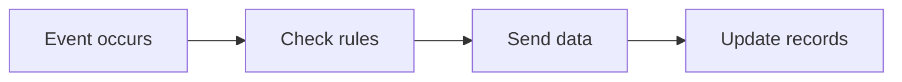

## Overview

Integrations let you connect AAMP Development to the systems your team already uses, such as CRM platforms, messaging tools, analytics services, and internal automation tools. This page is a starter kit template, so you can adapt the examples to match your own stack and workflows.

Use integrations when you want to sync data, trigger actions across tools, embed external content, or automate repeatable work. The goal is to keep your processes consistent while reducing manual steps.

<Callout kind="info">

This page uses generic examples so you can customize endpoints, field names, and authentication methods for your own environment.

</Callout>

## Common integration patterns

<Columns cols={3}>
  <Card title="Third-party connections" icon="cloud" href="#connection-setup">
    Connect external services through APIs, webhooks, or native connectors.
  </Card>
  <Card title="Data syncing" icon="database" href="#data-syncing">
    Keep records aligned between AAMP Development and your other systems.
  </Card>
  <Card title="Workflow automation" icon="zap" href="#workflow-automation">
    Trigger actions automatically when events happen in your product.
  </Card>
  <Card title="Embed and link options" icon="external-link" href="#embed-and-link-options">
    Add dashboards, forms, or deep links to support team workflows.
  </Card>
  <Card title="Secure setup" icon="shield" href="#security-considerations">
    Protect credentials, permissions, and data flow boundaries.
  </Card>
  <Card title="Implementation examples" icon="code" href="#implementation-example">
    Review a practical setup you can adapt for your own integration.
  </Card>
</Columns>

## Connection setup

Before you configure an integration, decide whether you need a direct API connection, an OAuth-based user connection, or a webhook-only setup. Each pattern solves a different problem.

<Steps>
  <Step title="Choose the integration method" icon="settings">
    Pick the connection style that matches your use case.

    - Use an API key when a service needs server-to-server access.
    - Use OAuth when users must grant access to their own accounts.
    - Use webhooks when you only need event notifications.
  </Step>
  <Step title="Register the application" icon="book-open">
    Create the app or integration record in the external service and capture the credentials it provides.

    Typical values include a client ID, client secret, and redirect URL.
  </Step>
  <Step title="Configure callback URLs" icon="arrow-right">
    Add your callback or redirect URL in both systems so authentication and event delivery work reliably.

    Keep the URL exact, including the path and protocol.
  </Step>
  <Step title="Test a sample request" icon="check-circle">
    Send a test payload to confirm that authentication, permissions, and data mapping all work as expected.
  </Step>
</Steps>

## Implementation example

The following example shows a common pattern: your app sends customer updates to an external service and stores the sync status locally. Replace the fields with the ones used by your tools.

<CodeGroup tabs="JavaScript,Python,cURL">
  ```javascript
  const payload = {
    externalId: "acct_20481",
    companyName: "Northwind Retail",
    plan: "pro",
    lastUpdatedAt: "2026-10-28T09:30:00Z"
  };

  const response = await fetch("https://api.example.com/integrations/sync", {
    method: "POST",
    headers: {
      "Content-Type": "application/json",
      "Authorization": "Bearer YOUR_API_KEY"
    },
    body: JSON.stringify(payload)
  });

  const result = await response.json();
  console.log(result.status);
  ```

  ```python
  import requests

  payload = {
      "externalId": "acct_20481",
      "companyName": "Northwind Retail",
      "plan": "pro",
      "lastUpdatedAt": "2026-10-28T09:30:00Z"
  }

  headers = {
      "Content-Type": "application/json",
      "Authorization": "Bearer YOUR_API_KEY"
  }

  response = requests.post(
      "https://api.example.com/integrations/sync",
      json=payload,
      headers=headers,
      timeout=30,
  )

  print(response.json()["status"])
  ```

  ```bash
  curl -X POST https://api.example.com/integrations/sync \
    -H "Content-Type: application/json" \
    -H "Authorization: Bearer YOUR_API_KEY" \
    -d '{
      "externalId": "acct_20481",
      "companyName": "Northwind Retail",
      "plan": "pro",
      "lastUpdatedAt": "2026-10-28T09:30:00Z"
    }'
  ```
</CodeGroup>

## Data syncing

When you sync data between systems, define a clear source of truth. For example, your CRM may own customer contact details, while AAMP Development owns workflow state or internal notes.

Use these practical rules:

- Sync only the fields you need.
- Map stable identifiers first, such as account ID or user ID.
- Add retry logic for temporary failures.
- Record a sync timestamp for every successful update.
- Keep conflict rules simple and documented.

### Sync strategies

<Tabs>
  <Tab title="One-way sync" icon="arrow-right">
    Use one-way sync when one system should always control the data. This reduces conflicts and simplifies troubleshooting.

    Common examples include sending signup events to a marketing tool or pushing status updates to a dashboard.
  </Tab>
  <Tab title="Two-way sync" icon="database">
    Use two-way sync only when both systems must stay aligned. You should define conflict rules before you go live.

    This approach works well for shared contact records or assigned task updates.
  </Tab>
  <Tab title="Event-driven sync" icon="zap">
    Use event-driven sync when you want updates to flow from triggers, such as a record change, completed purchase, or form submission.

    This is the most flexible pattern for automation-heavy workflows.
  </Tab>
</Tabs>

## Embed and link options

You can integrate external tools in two common ways: by embedding content directly or by linking users to the external system. Choose based on how much context you want to keep inside AAMP Development.

| Option | Best for | Notes |
| --- | --- | --- |
| Embed | Dashboards, forms, calendars | Keep the experience inside your product when the external tool supports safe embedding. |
| Deep link | Record detail pages, partner tools | Send users directly to a specific page with a stable URL. |
| Open in new tab | External portals | Best when you want to preserve the user's current session in AAMP Development. |

If you embed content, always verify authentication, permissions, and responsive layout. If you use links, make sure the destination URL is stable and easy to maintain.

## Workflow automation

Automation is the fastest way to get value from integrations. A typical workflow starts with an event, applies a condition, and then runs one or more actions.



Examples of useful automations include:

- Create a support ticket when a premium account reports an issue.
- Notify a team channel when a high-value lead signs up.
- Update a project board after a milestone is completed.
- Send a confirmation message after a form submission.

## Security considerations

<Callout kind="alert">

Do not store secrets in client-side code. Use server-side environment variables, rotate credentials regularly, and limit each integration to the minimum permissions it needs.

</Callout>

When you secure an integration, review these items:

1. Validate every inbound payload.
2. Use HTTPS for all requests.
3. Restrict webhook sources when possible.
4. Rotate tokens on a schedule.
5. Log failures without exposing sensitive values.

## Reference checklist

Use this checklist before you ship an integration:

- Confirm the authentication method.
- Test with a non-production account.
- Verify data mapping for each field.
- Handle retries and timeouts.
- Document who owns the integration.
- Decide how to monitor failures.

## Advanced setup

<ExpandableGroup>
  <Expandable title="How do I handle versioned APIs?" default-open="true">
    Pin to a specific API version when possible. This reduces unexpected behavior when the external service changes its payloads or response codes.
  </Expandable>
  <Expandable title="What if the external system is unavailable?" default-open="false">
    Queue the event, retry with backoff, and surface a clear error status to your support or operations team.
  </Expandable>
  <Expandable title="How should I support multiple environments?" default-open="false">
    Use separate credentials and endpoints for development, staging, and production so testing never affects real data.
  </Expandable>
</ExpandableGroup>

## Next steps

Start with one integration that solves a visible workflow problem, then expand from there. A small, reliable integration usually delivers more value than a large, fragile one.

<Columns cols={2}>
  <Card title="Quickstart" icon="rocket" href="/quickstart" horizontal>
    Set up your first workflow and test an API connection.
  </Card>
  <Card title="Authentication" icon="lock" href="/authentication" horizontal>
    Learn how to secure access with keys, tokens, or OAuth.
  </Card>
</Columns>