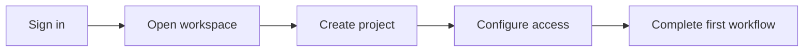

## Overview

Welcome to the AAMP Development quickstart. This starter kit helps you move from a fresh account to a working workspace, a first project, and a clean dashboard flow you can reuse for future work.

Use this page as your default setup path. You can adapt the names, team roles, and configuration details later to match your own process.

<Callout kind="info">
This is a starter kit template. Replace the example workspace name, project details, and access settings with your own values.
</Callout>

<Columns cols={3}>
  <Card title="Workspace Setup" icon="users" href="#workspace-setup">
    Create a workspace and define who can access it.
  </Card>
  <Card title="First Project" icon="book-open" href="#first-project-setup">
    Build a first project with a clear structure and purpose.
  </Card>
  <Card title="Dashboard Navigation" icon="monitor" href="#dashboard-navigation">
    Learn the core areas you will use every day.
  </Card>
</Columns>

## Prerequisites

Before you begin, make sure you have the following:

- A valid account with permission to create a workspace
- A project name ready for your first setup
- Basic access details for your team or test users
- A browser session that can reach your dashboard

If you are setting up AAMP Development for a team, decide who owns the first workspace, who can edit settings, and who should only view progress.

## Setup flow

<Steps>
  <Step title="Create your workspace" icon="users">
    Open the workspace creation screen and enter a clear name such as `AAMP Development Demo`. Choose a purpose that reflects the team or project you are organizing.

    Keep the name short and easy to recognize. A simple naming pattern helps everyone find the right workspace later.
  </Step>
  <Step title="Add your first project" icon="book-open">
    Create one project to verify that your workspace is ready. Use a name that matches the work you want to track, such as `Website Launch` or `Internal Operations`.

    Add a short description so new team members understand the goal without asking for more context.
  </Step>
  <Step title="Configure access" icon="lock">
    Assign the first people who need access. Start with the smallest useful group, then expand permissions after you confirm the workflow is working.

    Use role-based access when possible so you can separate admin tasks from everyday use.
  </Step>
  <Step title="Confirm your first workflow" icon="check-circle">
    Complete one end-to-end action, such as creating a task, updating a status, or publishing a draft item. This confirms that your setup is functional.

    A successful first workflow gives you a known-good baseline before you customize the rest of the system.
  </Step>
</Steps>

## Initial configuration

<CodeGroup tabs="JavaScript,Python,cURL">
  ```javascript
  const workspace = {
    name: "AAMP Development Demo",
    project: "Website Launch",
    visibility: "private",
    owner: "team-admin"
  };

  async function createWorkspace() {
    const response = await fetch("https://api.example.com/workspaces", {
      method: "POST",
      headers: {
        "Content-Type": "application/json",
        "Authorization": "Bearer YOUR_API_KEY"
      },
      body: JSON.stringify(workspace)
    });

    return response.json();
  }
  ```

  ```python
  import requests

  payload = {
      "name": "AAMP Development Demo",
      "project": "Website Launch",
      "visibility": "private",
      "owner": "team-admin"
  }

  response = requests.post(
      "https://api.example.com/workspaces",
      json=payload,
      headers={
          "Content-Type": "application/json",
          "Authorization": "Bearer YOUR_API_KEY"
      }
  )

  print(response.json())
  ```

  ```bash
  curl -X POST "https://api.example.com/workspaces" \
    -H "Content-Type: application/json" \
    -H "Authorization: Bearer YOUR_API_KEY" \
    -d '{
      "name": "AAMP Development Demo",
      "project": "Website Launch",
      "visibility": "private",
      "owner": "team-admin"
    }'
  ```
</CodeGroup>

## Platform-specific setup

<Tabs>
  <Tab title="Dashboard" icon="monitor">
    Start in the dashboard to confirm your workspace, review recent activity, and check that your new project appears in the correct location.

    Look for the overview panel, project list, and any setup prompts that help you finish the first configuration.
  </Tab>
  <Tab title="Admin settings" icon="settings">
    Use the admin area to update workspace metadata, members, and permissions.

    Keep the initial configuration simple. You can add policies, labels, and automation after the first project is stable.
  </Tab>
  <Tab title="Team access" icon="users">
    Invite only the people who need immediate access. This reduces confusion and makes it easier to verify permissions during the first rollout.

    After the first successful setup, expand access in small groups and validate each change.
  </Tab>
</Tabs>

## Dashboard navigation

The dashboard should feel like a control center, not a maze. Focus on the areas you use most often:

1. **Workspace overview** — confirms the active workspace and shows current status.
2. **Projects** — lists your active work and allows quick entry into each project.
3. **Activity** — shows recent changes so you can confirm actions were saved.
4. **Settings** — contains access, naming, and configuration options.

If you need a simple mental model, use this flow:



## First successful workflow

Once your workspace is ready, complete one practical action that proves the setup is working. For example, you can create a sample task, assign it to a teammate, and update the status to done.

A clean first workflow should do three things:

- Confirm that your account can save changes
- Confirm that your permissions are correct
- Confirm that other users can find the new item

If something does not behave as expected, recheck your workspace name, access level, and project selection before you move on.

## Next steps

<Columns cols={2}>
  <Card title="Explore the basics" icon="book-open" href="#overview" horizontal>
    Review the key sections and repeat the setup with your own naming conventions.
  </Card>
  <Card title="Plan your rollout" icon="rocket" href="#first-project-setup" horizontal>
    Expand from a single project to a repeatable team workflow.
  </Card>
</Columns>

<Expandable title="What should you customize first?" default-open="false">
  
  Start with workspace naming, project structure, and access roles. Those three choices affect how easy it is to scale later.

  After that, adjust notifications, labels, and any dashboard shortcuts your team uses most often.
  
</Expandable>

<Callout kind="tip">
Use the same setup pattern for every new workspace so your team can learn one reliable process and reuse it consistently.
</Callout>